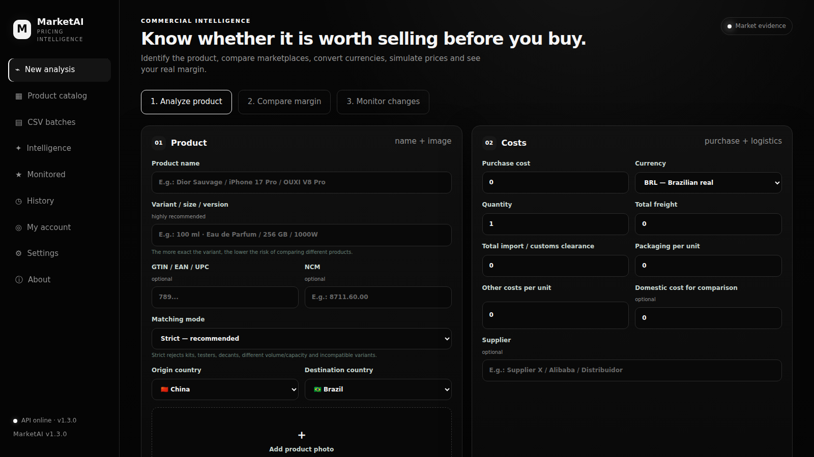
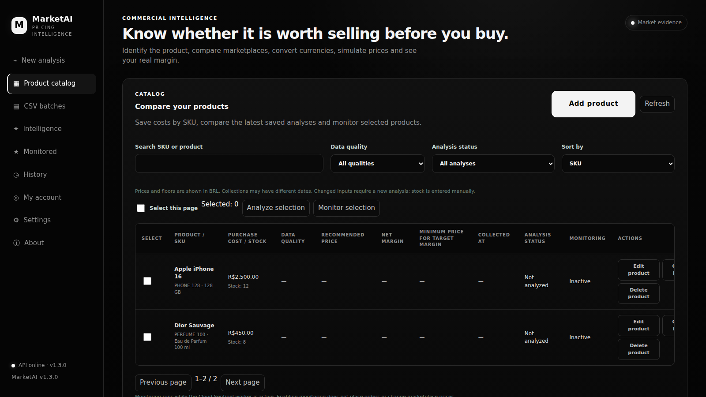
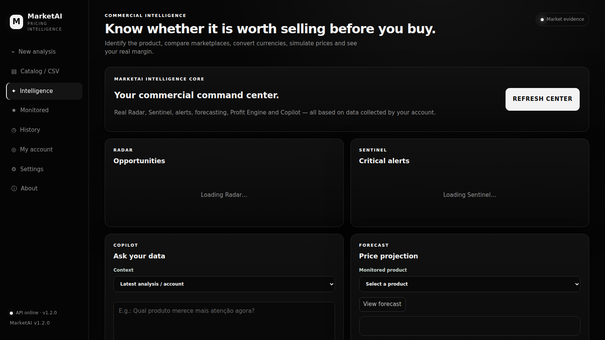
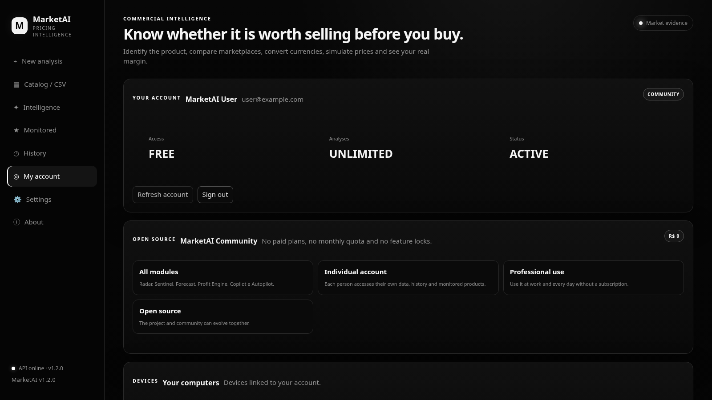
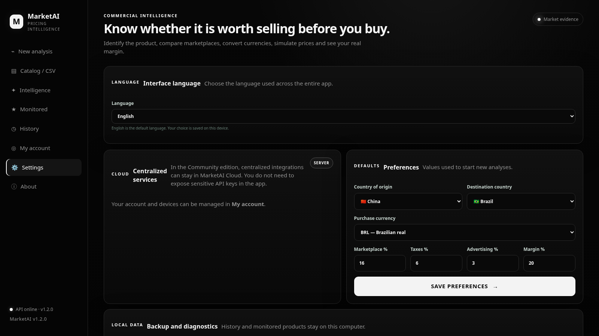
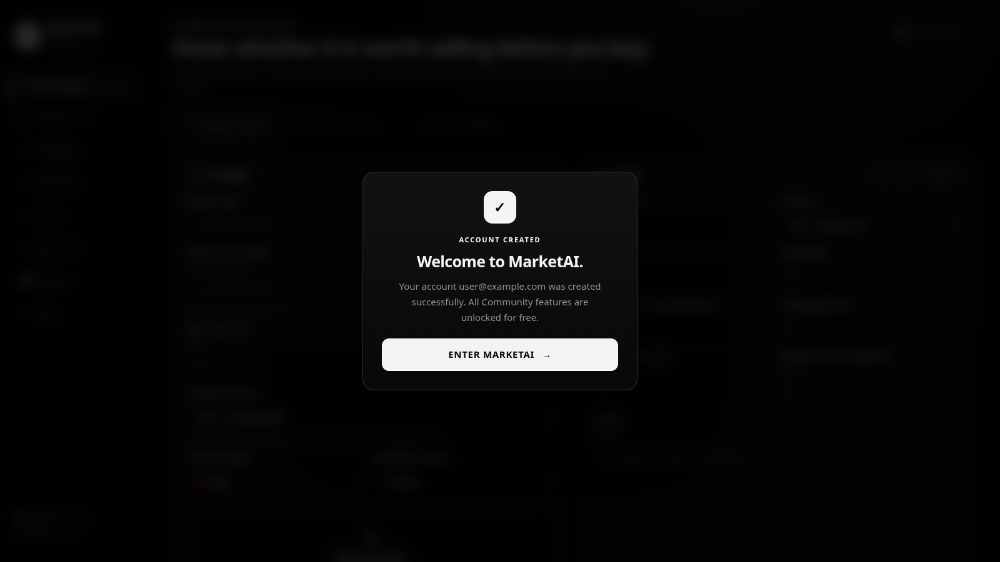
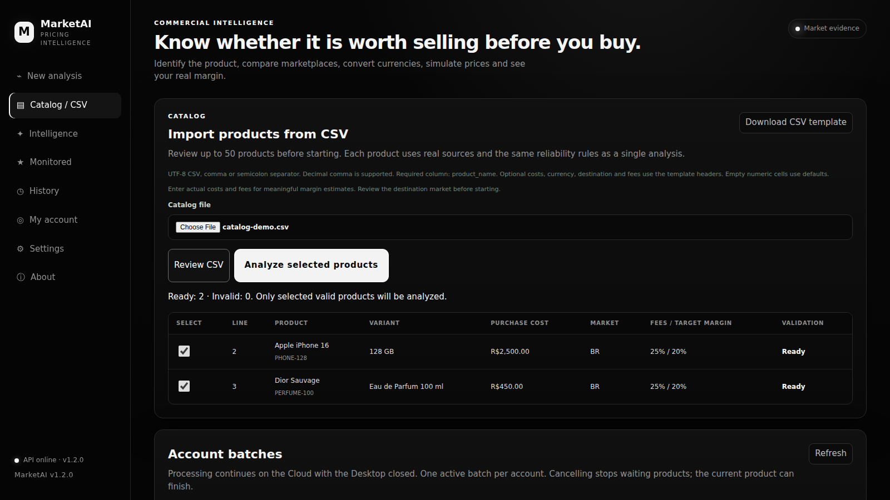

# MarketAI Community


> **Free and open-source market intelligence for pricing, margins, competition, monitoring and better product decisions.**

**MarketAI Community** is a free and open-source market intelligence platform designed for sellers, buyers, small businesses, analysts, students and teams that need better product decisions without a paywall.

Each person uses an individual account, with separate analyses, monitored products, history, snapshots and alerts.

**No paid plans. No trial limits. No monthly analysis quota. No Premium tier.**

> **Core rule:** MarketAI does not fabricate market prices, stock, sales or trends. If the available evidence is not strong enough, the app says so instead of inventing an answer.

## Download for Windows

Current version: **v1.2.0**

One multilingual installer for **Windows 10/11 x64**, with English, Português (Brasil), Deutsch, Español and Français.

```text
MarketAI-Setup-v1.2.0.exe
```

Direct download:

- [MarketAI-Setup-v1.2.0.exe](https://github.com/NyxPjct/MarketAI/releases/download/v1.2.0/MarketAI-Setup-v1.2.0.exe)
- [SHA-256 file](https://github.com/NyxPjct/MarketAI/releases/download/v1.2.0/MarketAI-Setup-v1.2.0.sha256)
- [GitHub Release v1.2.0](https://github.com/NyxPjct/MarketAI/releases/tag/v1.2.0)

SHA-256:

```text
2674c7cbc921724182bf6f8eb0cb5ccb49f8ed0ad58f2a44c709f6324e6ecb22
```

All releases:

https://github.com/NyxPjct/MarketAI/releases

## Languages

**English is the default language.**

The entire Desktop interface can be switched instantly between:

- English
- Português (Brasil)
- Deutsch
- Español
- Français

The selected language is saved on the device and reused the next time MarketAI starts.

The language switch is available on the login screen and inside **Settings**.

Language changes also update interface labels, forms, account screens, Intelligence Core messages, dynamic UI states, date formatting and currency formatting.

## Login first

MarketAI starts on the **Sign in / Create account** screen.

Accounts are used to keep each user's data separated, including:

- analyses;
- history;
- monitored products;
- snapshots;
- alerts;
- devices;
- Intelligence Core context.

After authentication, the user enters the main workspace.

## 100% free

MarketAI Community unlocks:

- unlimited product analyses inside MarketAI;
- MarketAI Intelligence Core;
- Market Score 0–100;
- Data Quality Score A–E;
- Profit Engine;
- Sentinel;
- Radar;
- Forecast;
- Autopilot;
- Copilot;
- alerts;
- account history synced across devices, with a local cache;
- multiple devices per account.

There is no active checkout in the Community edition.

Some legacy billing code remains in the repository for historical compatibility, but it does not control access to Community features.

## Open source

MarketAI is distributed under the **Apache License 2.0**.

You can study, use, modify and redistribute the software according to the license terms.

Important files:

- [LICENSE](LICENSE)
- [NOTICE](NOTICE)
- [CONTRIBUTING.md](CONTRIBUTING.md)
- [SECURITY.md](SECURITY.md)

## What is new in v1.3.0

- A saved, account-scoped product catalog with unique SKUs, variants, suppliers, manually entered stock and all pricing inputs.
- Add products manually or save selected valid CSV rows to the catalog. Existing SKUs are preserved; edit them with revision checks instead of overwriting them during imports.
- Edit costs and stock across devices, with a paginated change history and protection against stale edits.
- Compare each product's latest trusted analysis by quality, net margin, target price floor and collection date. Search by SKU/name, filter and sort across the entire catalog, with 50 products per page.
- Changed pricing inputs flag older results until a new analysis completes. Stock and supplier-only edits do not invalidate the pricing calculation.
- Reanalyze selected products without uploading another CSV, using the durable Cloud batch worker.
- Activate Sentinel monitoring for up to 50 selected products at once, reusing the same monitor for each SKU. Updating catalog costs updates its monitor without reactivating a paused one.
- Zero fees and a zero target margin are respected by the analysis engine.
- Catalog controls, editor, revision history and errors support all five interface languages.

### Use the saved catalog

1. Open **Product catalog → Add product**, or review a file in **CSV batches** and choose **Save selection to catalog**. Each saved product needs a SKU.
2. Enter the actual costs, currency, destination, fees, supplier and stock. SKU identifies the product and cannot be renamed; add another product for a different SKU.
3. Select products and choose **Analyze selection**. Follow the account batch from any device; processing continues with Desktop closed while Cloud is running.
4. Return to the catalog to filter reliable results, sort by margin or price floor, and open the full analysis. Prices and floors are in BRL. Collection dates may differ, and fallback exchange rates are labeled.
5. Choose **Monitor selection** to activate Sentinel. Its separate worker must be running for recurring collections; this action does not place orders or change marketplace prices.

The comparison uses saved server analyses collected after products enter the catalog. It does not convert imported history summaries into market evidence. Deleting a product removes its catalog revisions and comparison links and pauses its monitor; saved History analyses, previous snapshots and alerts remain. Clearing account History removes linked comparison results while keeping catalog inputs. Finished batch deletion remains independent. Catalog inputs and revisions are not included in the existing local History/watchlist backup export; back up the Cloud database for those records.

Deploy Cloud and Desktop **v1.3.0 together**. Startup creates only the additive `catalog_products`, `catalog_revisions` and `catalog_analyses` tables; existing tables are preserved. Take a database backup before deployment. Hosted login and live marketplace access require validation on the deployed instance.

## What is new in v1.2.0

- Import a product catalog from CSV, review each row and select the products to analyze.
- Track SKU, variant, purchase cost, currency, destination and fee assumptions.
- Accept UTF-8 CSV with comma, semicolon or tab separators, including decimal commas.
- Preview does not query marketplaces; processing begins only after confirmation.
- Durable Cloud batches continue with the Desktop closed and resume interrupted work.
- Inspect progress, errors and data quality per product, reopen analyses and export results.
- Cancel waiting products, retry failed products and delete finished batch records.
- Products without reliable evidence retain blocked prices instead of invented recommendations.
- The native launcher uses the central application version and respects the configured data directory.
- Windows release validation checks a clean installation, native window startup and upgrades from v1.0.5 and v1.1.0 with preference preservation.

The v1.2.0 release passed **65 Cloud tests, 17 Desktop tests**, the two-device browser regression and native Windows installation/upgrade checks. The [Windows validation report](.release/validation/windows-v1.2.0.json) confirms clean installation, native window startup and upgrades from v1.0.5 and v1.1.0 with preferences and user files preserved. Market-provider tests use controlled data; these checks do not establish that a hosted instance has live provider access.

### Import a catalog

1. Open **CSV batches** and download the template.
2. Fill `product_name` (required), plus `sku`, `variant_text`, `purchase_cost`, `purchase_currency`, `destination_country` and other supported template fields.
3. Review the CSV, destination, costs and fees. Only selected valid rows will run.
4. Start the batch and follow its progress from any device on the same account.
5. Open individual analyses, export results, or retry failed products.

Each file supports up to **50 products and 2 MB**; these are processing limits, not paid quotas. Blank numeric cells use the same analysis defaults (quantity 1, fees 16% + 6% + 3%, target margin 20%, currency BRL and destination BR). Enter actual costs and fees for useful margin estimates. Portuguese aliases such as `produto`, `variante`, `custo`, `moeda` and `quantidade` are also accepted. Preserve GTINs as text and use an unambiguous decimal separator.

Cloud and Desktop must both run v1.2.0. The Cloud starts its batch worker automatically and creates the additive `analysis_batches` and `analysis_batch_items` tables. Keep the API running for background processing. `BATCH_WORKER_ENABLED=0` disables processing for controlled tests or maintenance. Sentinel remains a separate worker for recurring monitoring. Completed batch summaries and individual History records have separate delete actions.

## What is new in v1.1.0

- Guided analysis flow: analyze the product, review evidence, compare margin, then monitor.
- Recommendation evidence highlights collection dates, listing counts, cost floors and blocked recommendations.
- Forecast uses elapsed days between real collections for 7-, 30- and 60-day projections. Small histories are marked preliminary; projections are extrapolations, not guaranteed future prices.
- Analyses are saved in account-scoped Cloud history. The Desktop displays the latest 80 records and can reopen full Cloud analyses. Local legacy records are imported once as summaries and are not verified evidence for Copilot.
- Monitored products use the Sentinel list on the Cloud, with device-local caches and explicit sync errors. Manual refresh retrieves changes from other devices. Clearing history or stopping monitoring applies to the account across devices.
- Copilot can focus on a monitored product or a saved analysis. Without an AI provider, it answers specific questions about margin, costs, alerts and forecasts using saved account data. Unsupported questions receive an explicit explanation.

The new `analysis_history` table is created by the Cloud's existing startup initialization. Existing tables and data are preserved. Deploy the Cloud and Desktop changes together; older Clouds do not expose the new history endpoints. Live third-party integrations require the operator’s credentials and independent validation.


## Screenshots — MarketAI v1.3.0

The screenshots below are generated automatically from the current Desktop interface in **English** at **1600×900**.

Demo values are used only to present the UI. They are not presented as real market evidence.

### Login / account creation


### Dashboard / New analysis



#### Saved SKU catalog



## Intelligence Core



### My account



### Settings

The Settings screen includes the interface language selector.



### Account-created confirmation



### Catalog / CSV review



## Intelligence Core

### Market Score

A 0–100 score that combines data quality, expected margin, price headroom and market depth.

### Data Quality Score

An A–E quality grade that shows how strongly the analysis is supported by compatible market evidence.

### Profit Engine

Calculates:

```text
Selling price
- unit cost
- fixed cost per unit
- marketplace fee
- taxes
- advertising
- payment fee
- estimated losses
= net profit
```

It also reports net margin, ROI and break-even price.

### Sentinel

Tracks monitored products and stores real market snapshots.

When the worker is running, monitoring can continue even while the Desktop app is closed.

### Radar

Ranks opportunities from real snapshots collected by Sentinel.

### Forecast

Builds projections from historical snapshots.

If there is not enough history, MarketAI does not create a fake trend.

### Autopilot

Suggests prices while respecting strategy and minimum margin constraints.

### Copilot

Answers questions using the real context available to the user's account.

When an external AI provider is not configured, MarketAI can fall back to deterministic logic instead of inventing facts.

## Product and market analysis

MarketAI supports:

- product name and variant matching;
- image-assisted identification;
- optional GTIN / EAN / UPC;
- brand and model comparison;
- perfume concentration and volume;
- storage capacity;
- power / wattage;
- kit, sample, decant, tester and replica rejection;
- Match Score;
- compatible vs discarded listing separation;
- outlier handling;
- ambiguous-variant blocking;
- insufficient-sample blocking;
- currency conversion;
- landed unit cost;
- pricing strategies;
- margin simulation;
- account history synced across devices, with a local cache;
- CSV and PDF-oriented exports.

## External data sources

The project contains support for integrations such as:

- Mercado Livre / Mercado Libre;
- eBay;
- Google Shopping through SerpApi;
- AI-assisted product identification and Copilot features.

**MarketAI itself is free**, but external services can have their own credentials, quotas, pricing or terms.

Open-source software cannot make a paid third-party API free.

Sensitive credentials should remain on the Cloud or in a self-hosted environment and must never be committed to the repository.

## Architecture

```text
┌──────────────────────────────┐
│     MarketAI Desktop         │
│ Windows · Account login      │
│ EN / PT-BR / DE / ES / FR    │
└──────────────┬───────────────┘
               │ HTTPS / JWT
               ▼
┌──────────────────────────────┐
│       MarketAI Cloud         │
│ FastAPI + authentication     │
├──────────────────────────────┤
│ Market Engine                │
│ Intelligence Core            │
│ Sentinel Worker              │
│ Accounts / devices           │
│ Admin / audit                │
└──────────────┬───────────────┘
               │
        ┌──────┴──────┐
        ▼             ▼
   PostgreSQL     External APIs
```

## Security and account isolation

- Argon2 password hashing;
- short-lived JWT access tokens;
- rotated refresh tokens stored as hashes;
- Windows DPAPI protection for local session data;
- random installation UUID instead of invasive hardware fingerprinting;
- Intelligence Core data scoped by authenticated user;
- synchronized history and Sentinel watchlists scoped by account;
- secrets excluded from the repository;
- HTTPS required for official release builds.

## Community Cloud

Current hosted Cloud instance:

```text
https://marketai-cloud-production.up.railway.app
```

Health endpoint:

```text
https://marketai-cloud-production.up.railway.app/health
```

The hosted environment uses:

- MarketAI Cloud;
- PostgreSQL;
- MarketAI Sentinel Worker.

The project can also be self-hosted.

## Local development

### Cloud

```bat
cd cloud
python -m venv .venv
.venv\Scripts\activate
pip install -r requirements.txt
copy .env.example .env
uvicorn app.main:app --reload --port 9000
```

### Sentinel Worker

```bat
cd cloud
.venv\Scripts\activate
python -m app.sentinel_worker
```

### Desktop

```bat
cd desktop
set MARKETAI_CLOUD_URL=http://127.0.0.1:9000
run_desktop_dev.bat
```

## Windows builds

Installer filenames follow the application version automatically.

```text
v1.2.0 -> MarketAI-Setup-v1.2.0.exe
v1.3.0 -> MarketAI-Setup-v1.3.0.exe
v2.0.0 -> MarketAI-Setup-v2.0.0.exe
```

Local build:

```bat
cd desktop
build_installer.bat
```

## CI/CD

Pushes and Pull Requests run:

- Cloud tests;
- Desktop tests;
- Python compilation checks;
- JavaScript syntax validation;
- two-device browser regression for guided analysis, durable batches, the saved SKU catalog, comparisons and bulk monitoring.

Updating `.release/windows.json` can trigger the Windows release pipeline and publish:

```text
MarketAI-Setup-vX.Y.Z.exe
MarketAI-Setup-vX.Y.Z.sha256
RELEASE-NOTES.txt
```

The pipeline also supports:

- SHA-256 verification;
- build provenance attestation;
- optional Windows Code Signing;
- automatic GitHub Releases;
- auto-update manifest publishing.

The screenshot workflow opens the current MarketAI Desktop UI with Playwright, forces **English**, validates all five supported languages, captures the current interface and commits the resulting images to `docs/screenshots/`.

See [RELEASE-PIPELINE.md](RELEASE-PIPELINE.md).

## Project structure

```text
MarketAI/
├── cloud/
│   ├── app/
│   ├── admin/
│   ├── tests/
│   └── docker-compose.yml
├── desktop/
│   ├── backend/
│   ├── frontend/
│   │   ├── app.js
│   │   ├── i18n.js
│   │   ├── index.html
│   │   └── style.css
│   ├── installer/
│   ├── tests/
│   └── docs/
├── docs/screenshots/
├── tools/
├── LICENSE
├── NOTICE
├── CONTRIBUTING.md
└── SECURITY.md
```

## Project philosophy

The goal is straightforward:

> build useful market intelligence software for people who work with products, without locking the core experience behind a paywall.

Contributions are welcome.

---

### MarketAI Community

**Find. Understand. Price. Monitor. Decide.**
